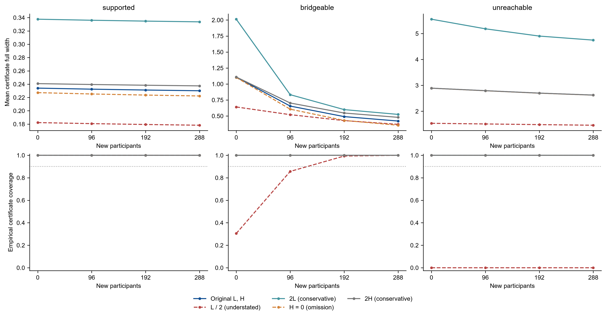

# 声明 L/H 与曲率组件消融

本轮在原一般 **U/L/H、simplex 权重、min(Bbar,BLip)** 流程中，只改变声明的平滑性界。完成3种函数×3种菜单×每格200世界，共1,800个独立世界；主结果为 **R2、288新增参与者**。相同世界的五组共享校准集合、实际研究观测和随机3桥前缀，随后各自重新优化设计型权重。所有预设场景、0/96/192/288预算和Rinf补充均保留。

本次最重要的发现是 **低估L可能使策略过早、自信地发布**：bridgeable中L/2在采满288人后覆盖600/600，但按δ=.3首次停止时有70/600次错误发布；平均只用107.84人，baseline为160.00人、错误发布0次。unreachable中L/2的主预算覆盖为0/600，几何违例600个。缩短区间和减少成本在此伴随可靠性丧失。

保守声明有明确代价：bridgeable的主预算平均全宽由baseline的0.421269增加到2L的0.524983、2H的0.479038。**删除H的负结果也保留**：H0的主预算共1800世界，几何违例0次、漏盖0次，本轮不能声称已实证展示删除曲率会失败；这也不为非线性H0补上统一保证。

这是参数声明的敏感性与组件归因，未改变真实函数，未依据上一轮proxy高覆盖调大噪声或更换阈值。模拟仍使用原两臂高斯观测；它不是新非高斯线性W选桥定理实验。

| 组 | 声明 | 保证身份 |
| --- | --- | --- |
| baseline | 原解析 L,H | 合法，合成条件下单policy完整路径失败概率至多0.10 |
| L_half | L/2,H | 三个函数上都低估真实域内L；负控制，无统一名义保证 |
| L_double | 2L,H | 合法但更保守 |
| H_zero | L,0 | linear与baseline完全相同；两个非线性函数上遗漏曲率，Bbar条件不足，BLip及拒绝外区间仍可合法 |
| H_double | L,2H | 合法但更保守；linear与baseline完全相同 |

解析界对应机制域 **[-1,1]²**，并非声称quadratic在整个欧氏空间具有有限L。校准球与该域相交，程序使用球的距离外包作保守计算。真实机制和凸包均在域内。半L低于解析梯度上确界；不能凭有限样本恰好覆盖就认证为有效L。

## 主预算：宽度、真实误差与两层覆盖

每行等量汇总三个函数，共600世界。全宽是固定预算证书宽度，不是拒绝外区间；MAE以全部目标为分母。`covered_count`指证书包含真实目标，`causal_geometry_violation_count`指真实加权迁移偏差超过声明几何界（容差1e-10），二者是不同事件。

| scenario | variant | n_worlds | mean_width | mae | covered_count | causal_geometry_violation_count |
| --- | --- | --- | --- | --- | --- | --- |
| supported | baseline | 600 | 0.230094 | 0.0153594 | 600 | 0 |
| supported | L_half | 600 | 0.178301 | 0.0153291 | 600 | 2 |
| supported | L_double | 600 | 0.333672 | 0.0153593 | 600 | 0 |
| supported | H_zero | 600 | 0.222278 | 0.0152271 | 600 | 0 |
| supported | H_double | 600 | 0.237437 | 0.0155016 | 600 | 0 |
| bridgeable | baseline | 600 | 0.421269 | 0.0334747 | 600 | 0 |
| bridgeable | L_half | 600 | 0.369296 | 0.0334072 | 600 | 0 |
| bridgeable | L_double | 600 | 0.524983 | 0.0335151 | 600 | 0 |
| bridgeable | H_zero | 600 | 0.355744 | 0.0331918 | 600 | 0 |
| bridgeable | H_double | 600 | 0.479038 | 0.0350027 | 600 | 0 |
| unreachable | baseline | 600 | 2.62457 | 0.920025 | 600 | 0 |
| unreachable | L_half | 600 | 1.46033 | 1.02504 | 0 | 600 |
| unreachable | L_double | 600 | 4.74786 | 0.878098 | 600 | 0 |
| unreachable | H_zero | 600 | 2.62272 | 0.920972 | 600 | 0 |
| unreachable | H_double | 600 | 2.62468 | 0.92002 | 600 | 0 |

按变体汇总主预算计数：

| variant | n_worlds | covered | causal_violations | legal_selected_bound |
| --- | --- | --- | --- | --- |
| baseline | 1800 | 1800 | 0 | 1800 |
| L_half | 1800 | 1200 | 602 | 0 |
| L_double | 1800 | 1800 | 0 | 1800 |
| H_zero | 1800 | 1800 | 0 | 606 |
| H_double | 1800 | 1800 | 0 | 1800 |

负控制更窄或发布更多，不能称为同有效性条件下的改进。负控制若没有经验失败，也不能因此补上理论保证。原声明和加倍声明的覆盖是本DGP证据，不是对未知真实平滑性的认证。全部九格的真实目标覆盖计数（每格分母200）：

| surface | scenario | baseline | L_half | L_double | H_zero | H_double |
| --- | --- | --- | --- | --- | --- | --- |
| linear | bridgeable | 200 | 200 | 200 | 200 | 200 |
| linear | supported | 200 | 200 | 200 | 200 | 200 |
| linear | unreachable | 200 | 0 | 200 | 200 | 200 |
| quadratic | bridgeable | 200 | 200 | 200 | 200 | 200 |
| quadratic | supported | 200 | 200 | 200 | 200 | 200 |
| quadratic | unreachable | 200 | 0 | 200 | 200 | 200 |
| sinusoidal | bridgeable | 200 | 200 | 200 | 200 | 200 |
| sinusoidal | supported | 200 | 200 | 200 | 200 | 200 |
| sinusoidal | unreachable | 200 | 0 | 200 | 200 | 200 |

上排为平均证书全宽，下排为真实目标覆盖；虚线90%表示合法完整声明的保守路径保证水平，不给L_half或非线性H_zero授予名义保证。H_zero汇总混合了合法的linear与两种遗漏曲率的非线性面，必须结合各格CSV解释。每时点是同一世界的重复记录，不额外计样本。

## 曲率或 L 的影响在哪一层

记代理中心c、集合半径r、目标c*、r*，真实来源效果μᵢ与真实目标μ*。程序计算：

$$\overline B=L\left(\left\|\sum_i a_ic_i-c_*\right\|+r_*+\sum_i a_ir_i\right)+\frac H4\sum_{i\ne j}a_i a_j(\|c_i-c_j\|+r_i+r_j)^2,$$

$$B_{Lip}=L\sum_i a_i(\|c_i-c_*\|+r_i+r_*),\quad R=\min(\overline B,B_{Lip})+N(a).$$

$$\widehat\mu-\mu_* = \underbrace{\sum_i a_i\mu_i-\mu_*}_{\text{causal error}}+\underbrace{\sum_i a_i(\widehat\mu_i-\mu_i)}_{\text{sampling error}}.$$

真实μ只用于事后评分，不输入优化、选桥或停止。检查绝对causal error是否被几何项覆盖，有助区分几何声明与噪声余量；并不要求每个错设声明在有限组合中必然违例。以下为同一主预算、每格200世界的几何违例数：

| surface | scenario | baseline | L_half | L_double | H_zero | H_double |
| --- | --- | --- | --- | --- | --- | --- |
| linear | bridgeable | 0 | 0 | 0 | 0 | 0 |
| linear | supported | 0 | 2 | 0 | 0 | 0 |
| linear | unreachable | 0 | 200 | 0 | 0 | 0 |
| quadratic | bridgeable | 0 | 0 | 0 | 0 | 0 |
| quadratic | supported | 0 | 0 | 0 | 0 | 0 |
| quadratic | unreachable | 0 | 200 | 0 | 0 | 0 |
| sinusoidal | bridgeable | 0 | 0 | 0 | 0 | 0 |
| sinusoidal | supported | 0 | 0 | 0 | 0 | 0 |
| sinusoidal | unreachable | 0 | 200 | 0 | 0 | 0 |

`fixed_summary_cells.csv`同时保存causal MAE、sampling MAE、几何和噪声均值；两种绝对误差的均值不能直接相加得到总MAE。严格“>0”的几何违例与容差1e-10版本分别保存，报告使用后者以免数值舍入当成数学反例。

单独归因使用 **baseline实际权重**：same_weight表不重新优化，噪声与点估计相同。增加L使Bbar和BLip均不减；增加H只增加Bbar，而BLip不变，取最小值后影响可能被另一分支挡住。重新优化后的变化还包含权重调整；多起点SLSQP没有全局最优保证，未强加跨组最优值排序。linear的H_zero/H_double与baseline输入、权重、点估计和半径相同，独立核验通过。

主预算、固定baseline权重下，H变化的各格平均半径变化见 `same_weight_summary_cells.csv`；完整18行保留。它与主表各自优化的效应不同，不能把两者混作曲率项的纯直接贡献。

## 发布与成本：按真实停点评价

下表列bridgeable两种预定半宽门槛。固定预算实验已采满共同前缀，停止表从同一批观测重建“首次R≤δ停止”，不是第二批独立数据。停止输出只用此前观测，后续行carry。

| variant | tolerance | release_count | n_worlds | mean_stopped_new_n | bad_release_count | released_mae |
| --- | --- | --- | --- | --- | --- | --- |
| baseline | 0.2 | 236 | 600 | 262.08 | 0 | 0.0356398 |
| L_half | 0.2 | 376 | 600 | 236.48 | 0 | 0.0363887 |
| L_double | 0.2 | 11 | 600 | 288 | 0 | 0.0266916 |
| H_zero | 0.2 | 531 | 600 | 224.32 | 0 | 0.0348963 |
| H_double | 0.2 | 181 | 600 | 262.08 | 0 | 0.0357452 |
| baseline | 0.3 | 600 | 600 | 160 | 0 | 0.0420545 |
| L_half | 0.3 | 600 | 600 | 107.84 | 70 | 0.119759 |
| L_double | 0.3 | 491 | 600 | 214.24 | 0 | 0.037526 |
| H_zero | 0.3 | 600 | 600 | 139.36 | 0 | 0.0431546 |
| H_double | 0.3 | 461 | 600 | 190.56 | 0 | 0.0438318 |

这里L/2、δ=.3的70次错误发布与主预算600/600覆盖并不矛盾：前者在首次达到被低估的半径门槛时停止，后者继续采集到288人再评价。同一批完整前缀重建的两个任务不能互换结论。该停止组的实际区间覆盖为519/600，较严格的区间漏盖事件与“误差超过δ”事件也不相同。δ=.2时L/2错误发布0次，其最终返回区间覆盖391/600，其中30个返回外区间不一致；拒绝并不自动等于返回了有效区间。

其余supported/unreachable以及Rinf的全部结果见 `stopped_summary_cells.csv` / `stopped_summary_scenarios.csv`。零发布的R2组有10行，条件MAE与条件错误率均记缺失，不填0。不同变体的发布子集及停点可能不同，条件MAE不能直接排名估计器准确性；主预算全目标MAE提供共同评价分母。`bad_release_count`指发布且真实误差超过δ，其无条件分母是全部世界。

成本仅计新增试验参与者；4×800历史人数共用并单列，校准、机制编码、部署成本未计。固定预算每世界成本固定288；停止成本可能更少，二者不混用。

拒绝时返回各组声明L计算的outer envelope，不是sharp PI。同前缀baseline/H_zero/H_double的拒绝端点必须相同，因为H不进入该式；它们若在不同前缀停止，最终输出可不同。空/不一致保留状态，不算零宽成功。若H_zero的某一步由合法BLip达到最小值，该数值界可以有合法依据；近似tie仅作诊断，不能把整个非线性H_zero策略重新标为有统一名义保证。声明合法性、单步选中界、实际返回界和机制集合覆盖事件分别记录。

H0在主预算的非线性unreachable两格中，共6/400个状态有严格合法BLip支持，其中2个默认active branch为Lipschitz、4个是精确并列。其余非线性状态不能仅凭经验覆盖就标为声明合法；linear的600个世界则本来就有H=0。这个区别已逐行审计。

## 配对差异、固定例和核验

主预算平均全宽变化（变体减baseline），探索性95%配对区间：

| scenario | variant | n_worlds | mean_variant_minus_baseline | exploratory_ci_low | exploratory_ci_high |
| --- | --- | --- | --- | --- | --- |
| supported | L_half | 600 | -0.0517932 | -0.0519179 | -0.0516649 |
| supported | L_double | 600 | 0.103577 | 0.103312 | 0.103817 |
| supported | H_zero | 600 | -0.00781626 | -0.00794532 | -0.00769201 |
| supported | H_double | 600 | 0.0073431 | 0.00723577 | 0.00745562 |
| bridgeable | L_half | 600 | -0.0519737 | -0.0521941 | -0.0517746 |
| bridgeable | L_double | 600 | 0.103713 | 0.103384 | 0.104066 |
| bridgeable | H_zero | 600 | -0.0655254 | -0.0674053 | -0.0636267 |
| bridgeable | H_double | 600 | 0.057769 | 0.0558747 | 0.0594541 |
| unreachable | L_half | 600 | -1.16424 | -1.17084 | -1.15786 |
| unreachable | L_double | 600 | 2.12329 | 2.10989 | 2.13684 |
| unreachable | H_zero | 600 | -0.0018555 | -0.00204703 | -0.00167524 |
| unreachable | H_double | 600 | 0.000106185 | 6.8519e-05 | 0.000143857 |

bootstrap按每函数×菜单内world配对重采，共2000次、seed=2026110773，再等权汇总三个函数。未做多重比较校正；方法、时点及阈值不成为独立样本。MAE、覆盖、真实causal偏差及几何违例的配对结果完整保存在 `paired_bootstrap.csv`。

预先指定 quadratic / bridgeable / replicate 0 的主预算分解：

| variant | declared_L | declared_H | Bbar | BLip | noise | radius | causal_error | sampling_error |
| --- | --- | --- | --- | --- | --- | --- | --- | --- |
| baseline | 0.697711 | 0.12 | 0.0807731 | 0.431718 | 0.147365 | 0.228138 | 0.027336 | 0.022728 |
| L_half | 0.348855 | 0.12 | 0.053495 | 0.215857 | 0.147365 | 0.20086 | 0.0273359 | 0.0227285 |
| L_double | 1.39542 | 0.12 | 0.135329 | 0.863439 | 0.147365 | 0.282694 | 0.0273361 | 0.0227279 |
| H_zero | 0.697711 | 0 | 0.0545558 | 0.454259 | 0.146477 | 0.201033 | 0.0289105 | 0.0205411 |
| H_double | 0.697711 | 0.24 | 0.10323 | 0.40788 | 0.150199 | 0.253429 | 0.0256709 | 0.0250408 |

全部阶段权重见 `single_world_fixed_states.csv`，真实两臂观测均值见 `single_world_observations.csv`。所有九格的校准事件计数见 `calibration_summary.csv`。独立审核直接排序保存的199个校准分数并重建每项公式，没有重新生成数据或重新优化。

原运行commit `dd68a1573daf52c3102077450b4215dafb697b63`，实际206.81秒；10项实现测试、26项运行检查通过。最初预估smoke5–20秒、full2–5分钟；smoke实测5.080秒并通过独立重建后，根代理在full启动前向作者更新为2–6分钟、4CPU。独立分析事前预估30–90秒，实际耗时与哈希见 `analysis_manifest.json`。

独立核验72,000个固定权重状态、144,000个停止输出和72,000个同权重状态；最大重建差：`{"geometry": 1.3322676295501878e-15, "estimate": 0.0, "refusal": 0.0, "stopped": 0.0, "same_weight": 8.881784197001252e-16, "error_decomposition": 0.0}`。所有源码/原始产物哈希、来源共享、实际成本、有效性标签、真实误差分解及停止端点已检查。不声称验证全局优化，也未运行任何真实数据。

## 审稿范围

| 问题 | 本轮能提供的证据与仍缺部分 |
| --- | --- |
| REV-01 | 非线性固定例与分解解释术语；不代替正文可读性审阅 |
| REV-02 | Rinf仅设计型补充，未验证结果适应选择的实际用途 |
| REV-03 | 新数字对应一般证书及声明敏感性，不自动替换摘要 |
| REV-04 / KoBT.W1、WGDN.W2a | 回答合成L/H保守或低估时的敏感性；真实U/L/H来源仍open |
| REV-05 | 无真实证书案例或微贷资格修复 |
| REV-06 | 未处理ManyLabs目标参考噪声 |
| REV-07 | 内部组件的匹配比较；无ExAtlas、sample splitting或direct优势证据 |
| REV-08 | 消融不解决已有工作、定理继承及新颖性归属 |
| REV-09 | 仍为simplex类，不证明它充分或优于合法signed/regression替代类 |
| REV-10 | 固定random桥前缀，不重新验证新W或旧logdet定理 |
| REV-11 | 新协议/源码/产物与旧分支分开；全稿归属核对仍未完成 |
| REV-12 | 声明、选中分支、拒绝输出、停止与条件分母分开，真实验收仍缺 |

没有审稿问题因消融成功运行而自动标为resolved。旧审计元数据修复由独立记录承载，不改变本轮模拟数据或既有论文数值。
