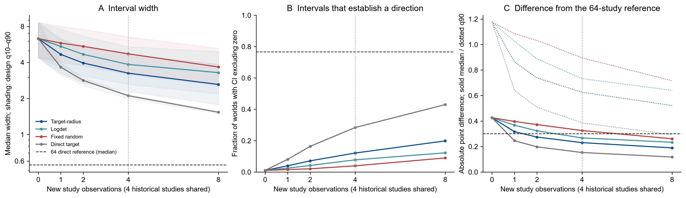

# 历史证据与有限桥接预算

本轮使用全部 200 个原存档设计，每设计 200 个世界。每世界先实际生成4项历史研究结果，所有策略共享；新增预算0、1、2、4、8均实际采集。**主预算为4，8仅为预定补充。**另有共享历史、未来噪声独立的64次直接目标观测参考，它不是模拟真值。

## 主预算4：实际回答了什么

目标选桥的区间宽度中位数为 3.253，各设计绝对缩短量的中位数为 2.874，相对各自历史区间缩短比例的中位数为 46.79%。与64次直接参考的绝对点差中位数为 0.2306，90%分位为 0.6257；差不超过.30的比例为 61.27%。

但在参考已经给出方向的 30,658 个世界里，目标选桥同向 4,841 个（15.79%），仍证据不足 25,816 个（84.21%），反向 1 个（0.003262%）。真实目标MAE为 0.293；同预算direct的对应MAE为 0.1817。本轮主预算4的结果支持定向选桥相对其他选桥规则的改善，尚不支持它已与64次direct得到相近的方向结论；同预算direct的点差和方向能力更好。区间单调缩短本身只是当前公式的保证。

| 方法 | 区间宽度中位数 | 相对历史缩短 | 点差≤.30 | 参考定向时同向 | 参考定向时仍不足 | 真值MAE |
| --- | --- | --- | --- | --- | --- | --- |
| target_radius | 3.253 | 46.79% | 61.27% | 15.79% | 84.21% | 0.293 |
| logdet | 3.849 | 37.69% | 54.96% | 10.11% | 89.88% | 0.344 |
| frozen_random | 4.717 | 21.21% | 46.84% | 5.16% | 94.84% | 0.4202 |
| direct_target | 2.108 | 66.68% | 80.64% | 36.99% | 63.01% | 0.1817 |

宽度及其缩短按 **200 个设计**统计；随机世界不会增加成本/宽度的有效样本数。点差和方向率是各设计等量世界的描述汇总，每设计的完整统计在 `per_design_metrics.csv`。没有把多个预算或四种方法当成新增独立世界，没有使用结果挑预算，也没有做未声明的总体显著性检验。

同预算的配对宽度比较如下。target更窄/更宽都完整保留，不能用与历史比较替代与强对照比较。

| new_budget | comparator | designs | target_narrower | equal_width | target_wider | median_target_minus_comparator_width | median_target_over_comparator_width |
| --- | --- | --- | --- | --- | --- | --- | --- |
| 4 | logdet | 200 | 193 | 0 | 7 | -0.5516 | 0.8566 |
| 4 | frozen_random | 200 | 200 | 0 | 0 | -1.253 | 0.7288 |
| 4 | direct_target | 200 | 10 | 0 | 190 | 1.157 | 1.557 |

图A阴影为200个设计的10%–90%分位，不是置信带。图B按区间是否排除0判断方向。图C实线为点差中位数、点线为90%分位，横虚线为预定.30尺度。预算4竖线只标记预定主预算。参考64的宽度和方向能力另作水平参照，没有把它放进相同费用的位置。

## 方向一致不等于结论正确

区间下界>0记正，区间上界<0记负，其余记证据不足。下表分母均为全部世界；“双方不足”单独列出，不能把这部分当作成功发现方向。

| 方法 | 三分类一致 | 双方不足 | 双方定向且同向 | 双方定向但反向 |
| --- | --- | --- | --- | --- |
| target_radius | 35.45% | 23.35% | 12.10% | 1 (0.0025%) |
| logdet | 31.10% | 23.35% | 7.75% | 1 (0.0025%) |
| frozen_random | 27.30% | 23.35% | 3.96% | 1 (0.0025%) |
| direct_target | 51.67% | 23.32% | 28.35% | 0 (0.0000%) |

仅在参考有方向的世界中，分成同向、策略不足、反向三个互斥结果。这是描述性条件比例，不是条件覆盖保证：

| 方法 | 参考定向分母 | 同向 | 策略不足 | 反向 |
| --- | --- | --- | --- | --- |
| target_radius | 30658 | 15.79% | 84.21% | 1 (0.003262%) |
| logdet | 30658 | 10.11% | 89.88% | 1 (0.003262%) |
| frozen_random | 30658 | 5.16% | 94.84% | 1 (0.003262%) |
| direct_target | 30658 | 36.99% | 63.01% | 0 (0.000000%) |

完整3×3混淆表位于 `direction_confusion.csv`：每方法每预算都保留参考负/不足/正 × 策略负/不足/正的九个格子。所有策略与参考共享真实参数及历史噪声，因此一致性带有关联；参考未来噪声独立于所有低预算策略，包括低预算direct，避免额外嵌套共享造成对direct的特殊优待。

## 独立真值评分与参考质量

| method | n_worlds | mae | rmse | covered_count | coverage | wrong_direction_count |
| --- | --- | --- | --- | --- | --- | --- |
| target_radius | 40000 | 0.293 | 0.3889 | 39989 | 0.999725 | 1 |
| logdet | 40000 | 0.344 | 0.4601 | 39976 | 0.999400 | 2 |
| frozen_random | 40000 | 0.4202 | 0.5604 | 39982 | 0.999550 | 1 |
| direct_target | 40000 | 0.1817 | 0.2335 | 39975 | 0.999375 | 2 |

参考共 40,000 个世界，覆盖 39,998/40,000（0.999950），MAE=0.049359，RMSE=0.06211；能给方向的比例为 76.64%，错误定向 0 次。其实际全宽范围为 [0.547878, 0.558305]。64来自运行前确定的设计上界：$q\le .25/64$，所以全宽不超过 $2\sqrt{.25/(64\times.05)}=.559017$。这保证一个精度尺度，不保证目标远离0，也不保证每个世界的参考值准确。

错误定向是已给正/负方向却与模拟真目标符号相反，以上数量分母是全部世界。覆盖和真实误差独立评分，绝不以参考当真值。逐设计覆盖的Wilson区间基于每设计200世界，未作跨设计多重比较校正；没有声称所有预算同时覆盖或观察历史后的条件覆盖。

## 全部预定预算

| method | new_budget | median_width | median_width_reduction | median_absolute_point_difference | point_difference_le_030_rate | decisive_rate |
| --- | --- | --- | --- | --- | --- | --- |
| direct_target | 0 | 6.326 | 0 | 0.4264 | 0.3705 | 0.0106 |
| direct_target | 1 | 3.652 | 0.4228 | 0.2454 | 0.5881 | 0.08073 |
| direct_target | 2 | 2.829 | 0.5529 | 0.1975 | 0.6912 | 0.1638 |
| direct_target | 4 | 2.108 | 0.6668 | 0.1533 | 0.8064 | 0.2838 |
| direct_target | 8 | 1.534 | 0.7575 | 0.1176 | 0.9077 | 0.4301 |
| frozen_random | 0 | 6.326 | 0 | 0.4264 | 0.3705 | 0.0106 |
| frozen_random | 1 | 5.802 | 0.03634 | 0.3968 | 0.3956 | 0.0156 |
| frozen_random | 2 | 5.455 | 0.0852 | 0.3723 | 0.4163 | 0.02065 |
| frozen_random | 4 | 4.717 | 0.2121 | 0.3254 | 0.4684 | 0.03963 |
| frozen_random | 8 | 3.664 | 0.3851 | 0.2609 | 0.5575 | 0.08985 |
| logdet | 0 | 6.326 | 0 | 0.4264 | 0.3705 | 0.0106 |
| logdet | 1 | 5.446 | 0.08577 | 0.3675 | 0.4203 | 0.02482 |
| logdet | 2 | 4.673 | 0.2043 | 0.3231 | 0.4708 | 0.0419 |
| logdet | 4 | 3.849 | 0.3769 | 0.2677 | 0.5496 | 0.0776 |
| logdet | 8 | 3.287 | 0.4647 | 0.2334 | 0.6094 | 0.1225 |
| target_radius | 0 | 6.326 | 0 | 0.4264 | 0.3705 | 0.0106 |
| target_radius | 1 | 4.665 | 0.2461 | 0.3165 | 0.4782 | 0.03957 |
| target_radius | 2 | 3.954 | 0.3661 | 0.2743 | 0.5383 | 0.07135 |
| target_radius | 4 | 3.253 | 0.4679 | 0.2306 | 0.6128 | 0.1211 |
| target_radius | 8 | 2.62 | 0.5633 | 0.1892 | 0.6979 | 0.1986 |

预算0是同一历史起点，四策略结果相同；所有后续区间中心实际使用历史与新增Y。研究成本仅计新增次数，既有4项单列；不是参与者人数、货币或现实跨研究成本。固定预算策略实际采到8次，不在达到某阈值时提前停止。

## 固定示例：设计0、世界0

四个历史观测（候选编号从0起）：

| history_position | candidate_type | observed_y | noise_sd |
| --- | --- | --- | --- |
| 0 | 6 | 1.188 | 0.5 |
| 1 | 3 | 0.4122 | 0.5 |
| 2 | 0 | 3.692 | 0.5 |
| 3 | 9 | -0.2383 | 0.5 |

目标选桥在预定预算的更新：

| stage | selected | estimate | lower | upper | width | ci_sign | point_difference |
| --- | --- | --- | --- | --- | --- | --- | --- |
| 0 | — | -1.066 | -5.123 | 2.991 | 8.114 | 0 | 0.2826 |
| 1 | 2 | -1.504 | -3.804 | 0.7969 | 4.601 | 0 | -0.1552 |
| 2 | 4 | -1.793 | -3.75 | 0.1649 | 3.915 | 0 | -0.4443 |
| 4 | 2 | -1.38 | -3.087 | 0.3265 | 3.413 | 0 | -0.03184 |
| 8 | 4 | -0.8749 | -2.273 | 0.5235 | 2.797 | 0 | 0.4734 |

该世界真实目标为 -1.32876，参考点估计为 -1.34831，两者分开保存。逐次的选择、新Y和更新见 `single_world_steps.csv` 与原始ledger；不是根据结果挑选的示例。

## 定理与实现接口

原先验P仍为假定已知的二阶矩。历史四项不是重新命名的先验：它们的真实Y和设计均显式进入下面的求和，其中每次重复采集都是新的独立观测索引。

$$A=P^{-1}+\sum_{i\in H\cup S}x_ix_i^\top/v_i,\quad V=A^{-1},\quad a_i=t^\top Vx_i/v_i,\quad\widehat\theta=\sum_{i\in H\cup S}a_iY_i.$$

$$d=\sum_i a_ix_i-t,\quad W=d^\top Pd+\sum_i a_i^2v_i=t^\top Vt,\quad R=\sqrt{W/.05}.$$

每一步枚举候选更新后的W并选择最小者，同时核对 $W_{next}=W-(t^\top Vx_b)^2/(v_b+x_b^\top Vx_b)$。logdet和固定随机只替换选择规则，估计器与半径相同。下一步最优不等于整个预算全局最优。

beta和所有研究噪声实际抽取标准化Student-t5，保留原P和sigma。设计和矩信息在观察Y之前固定，Y仅用于更新中心。保证联合覆盖随机beta、历史噪声和新噪声；V不是非高斯条件后验协方差。这里仍是已知矩的线性结构化分支，没有运行一般U/L/H校准、simplex权重与sharp拒绝集流程。

## 核验、时长与来源

原 full 运行耗时 63.2 秒，10项实现测试、19 项运行检查通过；测试记录见原目录 `test_log.txt`。代码提交 `ba7f3dc6d14f3de79a361365a1f0eb47d28b6594`，源档案哈希 `a050a387051b95952979dbe52d2faf84fa784213085f9824919b634c5d1246e7`。运行前预告full约1–3分钟，smoke后对一个200世界设计的生成/写入/检查实测为0.285秒，据此更新为60–120秒；该计时子集不作为额外独立世界合入结果。分析绘图耗时在 `analysis_manifest.json` 单独记录，本报告没有重新采样。

独立分析不导入实验实现，从原档案重算 20,200 个路径状态、4,800 次选桥，并从历史Y及未来前缀观测和重建全部 840,000 个端点。固定示例也从逐次观测重建。最大差为 `{"W": 5.551115123125783e-16, "q": 2.6645352591003757e-15, "weights": 1.7763568394002505e-15, "next_W": 2.3314683517128287e-15, "estimate": 6.750155989720952e-14, "reference_estimate": 0.0, "trace_estimate": 1.865174681370263e-14}`。来源与产物哈希均核对，详见 `independent_audit.json`。

## 审稿问题完整回顾

| 问题 | 本轮证据与边界 |
| --- | --- |
| REV-01 | 有真实历史起点和逐次例子，支持解释；正文可读性仍需作者审阅 |
| REV-02 | 仍为设计型权重/选择，未提供R∞结果适应性效用 |
| REV-03 | 新数字只绑定此历史线性分支，不自动更新摘要 |
| REV-04 | 已知P/x/v与合成历史不等于真实U、L、H校准 |
| REV-05 | 合成历史复用闭环，不是真实应用闭环 |
| REV-06 | 未新增Many Labs噪声证据 |
| REV-07 | 同历史、同新增预算、强direct对照与独立未来参考；未验证现实经济成本 |
| REV-08 | 运行结果不证明新颖性，相关文献仍需独立比较 |
| REV-09 | 线性矩估计器可有负权重，不验证一般simplex类最优 |
| REV-10 | 实际非高斯抽样、W与单步选桥一致；线性、已知矩和单步范围保留 |
| REV-11 | 版本、原档案、历史与未来流明确，不能混同一般U模型或旧压力测试 |
| REV-12 | 点差、三分类方向、参考不确定性和真值风险分开；固定预算不声明全路径保证 |

没有因跑通而关闭任何审稿问题。是否足以支持作者想要的有限预算效用，应依据上述与对照、参考及真值的完整结果判断。
