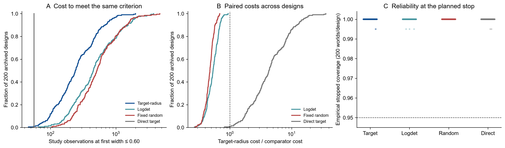
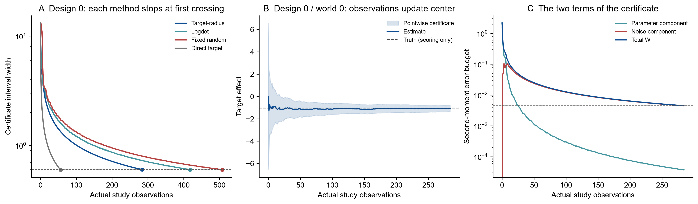

# 原论文设计上的非高斯选桥主实验

本轮完成 200 个原论文存档设计、每设计 200 个世界，共 40,000 个世界。四方法全部在冻结的完整区间宽度 ≤ 0.60 处停止。成本单位为一次独立研究级效果观测，原 σ=0.5；不换算参与者人数或人民币。此报告的主数据是 `full`，不合并 smoke、旧压力测试或旧 5,400 世界。

## 主要结论

以达到同一精度门槛所需的观测次数比较，target-radius 在 200/200 个设计中少于 logdet，在 200/200 个设计中少于固定随机。相对直接目标观测，则有 2/200 个设计更省，0/200 个相同，198/200 个更贵；逐设计成本比的中位数为 4.295。

这些结果检验了新定理在原存档设计中的执行和选桥效用。它们不能证明桥接普遍比直接目标实验便宜；原档案自身是随机合成设计，候选方向和幅度来自原生成器。这里没有为了本轮结果另设 0.1 或 2 的载荷，也没有筛除不利设计。费用比较是**相同宽度门槛**，不是每个最终区间恰好等宽；停止时越过门槛的幅度单独保留。

## 输入与概率含义

- 全部 200 组原始 p=6、12 候选的 prior、target、design、sigma 原样保留。源 SHA256：`a050a387051b95952979dbe52d2faf84fa784213085f9824919b634c5d1246e7`。
- beta = Cholesky(prior) z，z 的坐标独立标准化 Student-t5；每次观测噪声也是真实独立的标准化 Student-t5 乘原 sigma。参数与噪声独立。没有 Gaussian 近似采样。
- 每个候选允许独立重复观测；这是新流程相对原论文“四个不同候选子集比较”的明确变化。原先验二阶矩、噪声和几何均假定已知，没有完成真实数据校准。
- 所有方法共享相同参数、同类同访问序号的配对观测；不同访问生成新噪声。前三个方法仅改变选桥规则；direct 采用同先验、同 σ 直接观测目标。
- 半径与路径仅依赖已知设计；观测只更新区间中心。保证是每个固定设计下对随机参数和噪声的联合边际覆盖，不是固定 beta 条件覆盖、给定数据后的后验覆盖或全路径同时覆盖。

## 实际计算的公式

设候选类型 k 被独立观测 c_k 次，方差 v_k，P 为原先验协方差，t 为目标方向：

$$V=(P^{-1}+\sum_k c_k x_kx_k^\top/v_k)^{-1},\qquad a_k=x_k^\top Vt/v_k.$$

$$\widehat\tau=\sum_k a_k\sum_{j=1}^{c_k}Y_{kj},\quad d=\sum_k c_ka_kx_k-t,\quad W=d^\top Pd+\sum_k c_ka_k^2v_k=t^\top Vt.$$

$$I=[\widehat\tau-R,\widehat\tau+R],\qquad R=\sqrt{W/0.05}.$$

下一个候选 b 的实际更新满足

$$W_{next}(b)=W-\frac{(t^\top Vx_b)^2}{v_b+x_b^\top Vx_b}.$$

target-radius 枚举 12 个候选的实际新 W 并选最小者；代码同时核对该闭式增益。logdet 最大化 $\frac12\log(1+x_b^\top Vx_b/v_b)$；随机法循环预先冻结的随机排列。选择最小下一步 W 是单步最优，不自动成为整个停止预算的全局最优。

只要 R>0.30，就不宣告达到预设精度；采集所选类型的一次新观测后，重新计算全部权重、中心和半径。首次 R≤0.30 即停止。停止点由设计预先确定，因此本报告在该点使用 α=0.05，不把所有沿途区间解释为同时覆盖。Lean 验证的概率界和矩阵单步更新与本程序的对象相对应；实际 a、W 与矩阵 q 的连接由这里的独立数值审计核对，不声称 Python 程序本身经 Lean 验证。

## 成本与精度

成本分布的分母为 **200 个设计**，同一设计的 200 个随机世界不构成 200 份新的成本证据。

| method | designs | min_cost | q10_cost | median_cost | mean_cost | q90_cost | max_cost | min_width | median_width | max_width |
| --- | --- | --- | --- | --- | --- | --- | --- | --- | --- | --- |
| target_radius | 200 | 46 | 97.9 | 240.5 | 329.230 | 669.7 | 2000 | 0.5958 | 0.5995 | 0.6 |
| logdet | 200 | 66 | 173.8 | 451.5 | 664.460 | 1535 | 3772 | 0.5932 | 0.5995 | 0.6 |
| frozen_random | 200 | 104 | 218.9 | 512 | 700.515 | 1439 | 4704 | 0.5916 | 0.5995 | 0.6 |
| direct_target | 200 | 55 | 56 | 56 | 55.995 | 56 | 56 | 0.5947 | 0.5964 | 0.5999 |

配对成本比为 target-radius / 对照。`cheaper_and_no_wider` 进一步要求实际停止区间不比对照宽，可支持这些设计内的成本—宽度优势；它不代表全体设计的严格等宽比较。

| comparator | designs | target_cheaper | equal_cost | target_costlier | median_ratio | q10_ratio | q90_ratio | mean_ratio | ratio_of_total_cost | cheaper_and_no_wider |
| --- | --- | --- | --- | --- | --- | --- | --- | --- | --- | --- |
| logdet | 200 | 200 | 0 | 0 | 0.535 | 0.3893 | 0.6916 | 0.5389 | 0.4955 | 100 |
| frozen_random | 200 | 200 | 0 | 0 | 0.4755 | 0.371 | 0.575 | 0.4764 | 0.47 | 107 |
| direct_target | 200 | 2 | 0 | 198 | 4.295 | 1.748 | 11.96 | 5.879 | 5.88 | 0 |

固定已采观测次数下的宽度中位数如下。每个预算只保留四种方法**都实际采集到该步**的相同设计子集，`common_designs` 明示分母；未假装已停止方法继续采样。预算越大，该子集可能变化，不能把各行差异直接当作同一总体的学习曲线。完整 q10/q90 见 `fixed_budget_widths.csv`。

| study_observations | common_designs | direct_target | frozen_random | logdet | target_radius |
| --- | --- | --- | --- | --- | --- |
| 0 | 200 | 9.478 | 9.478 | 9.478 | 9.478 |
| 1 | 200 | 4.044 | 8.768 | 8.346 | 6.505 |
| 4 | 200 | 2.176 | 6.419 | 5.202 | 4.018 |
| 8 | 200 | 1.56 | 4.34 | 3.768 | 2.937 |
| 16 | 200 | 1.11 | 2.977 | 2.901 | 2.177 |
| 32 | 200 | 0.7878 | 2.224 | 2.133 | 1.573 |
| 55 | 199 | 0.6018 | 1.764 | 1.673 | 1.23 |
| 56 | 197 | 0.5964 | 1.763 | 1.66 | 1.221 |

## 停止时的可靠性

| method | worlds | covered_count | covered_rate | interval_misses | scientific_errors | mae | rmse |
| --- | --- | --- | --- | --- | --- | --- | --- |
| target_radius | 40000 | 39998 | 0.999950 | 2 | 2 | 0.05351 | 0.06711 |
| logdet | 40000 | 39997 | 0.999925 | 3 | 3 | 0.05336 | 0.06689 |
| frozen_random | 40000 | 40000 | 1.000000 | 0 | 0 | 0.05306 | 0.06671 |
| direct_target | 40000 | 39998 | 0.999950 | 2 | 2 | 0.05319 | 0.06696 |

上表是对全部原设计等量汇总的描述率；没有把方法配对或多个时点当成额外独立世界。`per_design_reliability.csv` 对每设计每方法的 200 个世界记录覆盖数及 95% Wilson 区间。这些区间未作跨设计多重比较校正，单个设计的经验覆盖低于 95% 本身不足以推翻或验证理论。Chebyshev 二阶矩界可较保守，高覆盖不等于成本效率高。

`interval_misses` 是真实目标落在实际返回区间之外；`scientific_errors` 是已达标时点估计误差超过 0.30。由于实际 R≤0.30，后一个事件包含于前一个事件，两者不能混为同一个指标。

## 固定单世界：设计 0、世界 0

该示例在运行前指定。真目标为 -1.04736，只用于事后评分，没有进入选桥、权重或停止决策。设计 0 四种方法的停止结果：

| method | cost | width | previous_width |
| --- | --- | --- | --- |
| target_radius | 284 | 0.5999 | 0.601 |
| logdet | 418 | 0.5994 | 0.6016 |
| frozen_random | 508 | 0.5993 | 0.6014 |
| direct_target | 56 | 0.597 | 0.6024 |

下表逐行是“决定类型 → 获得该次观测 → 更新估计与区间 → 判断精度”。stage 0 尚无观测，中心为先验均值 0；每类尚未被观测时，其权重不贡献估计。b0–b11 为原存档候选的零起始编号。

| stage | selected | observed_y | estimate | lower | upper | width | released |
| --- | --- | --- | --- | --- | --- | --- | --- |
| 0 | — | — | 0 | -6.574 | 6.574 | 13.15 | False |
| 1 | b2 | -2.903 | -1.247 | -4.836 | 2.342 | 7.179 | False |
| 2 | b0 | -2.506 | -0.7051 | -3.416 | 2.006 | 5.422 | False |
| 3 | b6 | -0.2058 | -0.9749 | -3.38 | 1.43 | 4.809 | False |
| 4 | b2 | -2.972 | -1.033 | -3.305 | 1.238 | 4.543 | False |
| 283 | b1 | -2.108 | -1.069 | -1.37 | -0.769 | 0.601 | False |
| 284 | b9 | 4.741 | -1.07 | -1.37 | -0.7701 | 0.5999 | True |

完整每一步可查原始 `single_world_trace.csv` 和 `single_world_observations.csv`；`single_world_steps.csv` 是便于阅读的合并副本。图中区间带是各时点区间的展示，未宣称整条带同时覆盖。

## 独立核验与可追溯性

运行代码 Git：`6bdbeb10c655e35ce6e2ed8820186682675932e7`。冻结协议：`revision/MAIN_THEOREM_WORKFLOW01.json`。原 full 运行耗时 180.3 秒，9 项实现测试及 10 项运行检查全部通过。分析与绘图没有预先单独计时，因此不追记其耗时。

本报告分析器不导入实验实现，没有重新生成样本。它从源快照独立重算 350,840 个路径状态的矩阵、实际权重、W 两项、半径和第一停止点；核对 338,841 次候选选择；从各类观测和重建全部 160,000 个端点估计，并从逐次观测重建固定示例。路径状态与候选次数是重复核对的数量，不能当作独立统计样本量。

最大绝对差：`{"W": 1.7763568394002505e-15, "q": 1.3988810110276972e-14, "weight": 4.440892098500626e-15, "radius": 2.6645352591003757e-15, "selected_next_W": 1.099120794378905e-14, "type_stat_weight": 6.800116025829084e-16, "estimate": 4.604649994632837e-13, "trace_estimate": 2.2648549702353193e-14}`。全部源文件与产物哈希已核对，详情见 `independent_audit.json`；原运行测试与检查见 raw 目录中的 `test_log.txt` 和 `run_manifest.json`。

## 全部审稿问题回顾

| 问题 | 本轮新增证据 | 仍未覆盖 |
| --- | --- | --- |
| REV-01 / nrhq：解释与首现定义 | 预先指定的逐次流程、公式和可复核观测 | 正文可读性仍需作者审阅 |
| REV-02：R∞ 的适应性用途 | 明确本轮是设计型选择与停止 | 未测试 outcome-adaptive 权重或 sample splitting |
| REV-03：数字归因 | 新数字明确归属此非高斯结构化分支 | 未自动更新摘要或全论文旧数字 |
| REV-04：真实机制与 L,H | 原存档与已知二阶矩来源可追溯 | 无真实机制集合/二阶矩校准 |
| REV-05：真实闭环 | 合成线性流程实际采样、更新、停止 | 无真实应用闭环 |
| REV-06：Many Labs 噪声 | 无新增证据 | 本轮不是 Many Labs |
| REV-07：基线与成本 | 同精度门槛、三种选桥与 direct、全部不利设计保留 | 费用按研究观测计；现实成本与任务差异未验证 |
| REV-08：新颖性与相关工作 | 无新增证据 | 仍需文献比较 |
| REV-09：simplex 估计类 | 明确使用结构化线性权重 | 不证明原 simplex 类普适最优 |
| REV-10 / KoBT.W4：Gaussian 与选桥定理 | 非高斯真实抽样；W 直接驱动下一步区间选择；独立公式核对 | 保留线性模型、已知二阶矩；单步最优不等于全预算最优 |
| REV-11：版本与命名 | 主分支、协议、代码、结果来源明确 | 全文命名与旧结果归属仍需系统整理 |
| REV-12：拒绝、停止与风险 | 首次精度停止、区间漏盖和科学错误分开，逐设计可靠性 | 不给真实校准或 outcome-driven 可选停止保证 |

本轮推进 REV-07、REV-10、REV-12 的限定证据，并帮助 REV-01；不因运行完成将任何问题自动改成 resolved。原一般 U/L/H 机制工作流与此已知矩结构化分支的范围必须在论文中明确区分。
