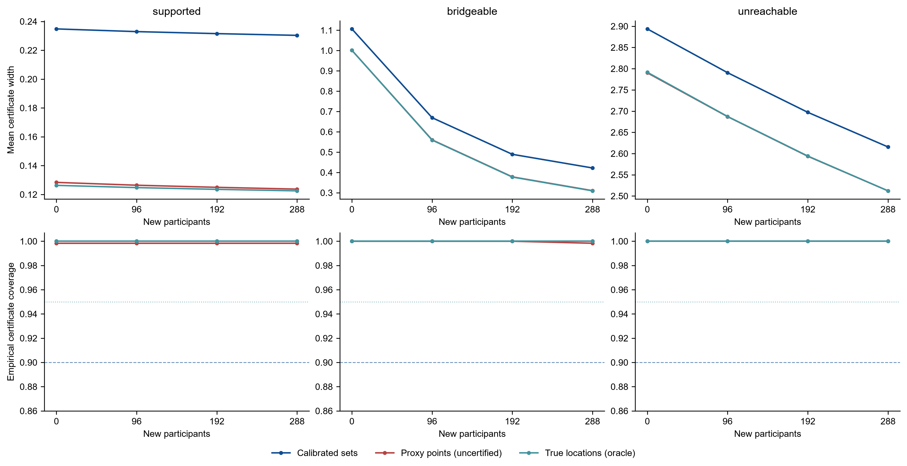

# 机制集合不确定性消融

本轮完成 1,800 个独立世界：3种函数×3种机制菜单×每格200世界。主比较为 **R2、固定288新增参与者**，Rinf及新增0、96、192人的预算点为预先规定的补充。所有方法共享4项历史研究、相同3桥随机前缀、同一批实际观察结果、L/H和噪声；只改变机制输入及据此优化的权重。

这检验的是原一般 **U/L/H、simplex权重、min(Bbar,BLip)** 计算证书；不是非高斯线性W选桥定理。当前采集顺序固定随机，没有检验定向选桥。三种输入不能被视作具有相同可用信息和理论保证的普通算法：

- `calibrated_U`：代理中心加联合校准球；在声明的合成条件下，每个policy的完整路径覆盖至少90%。
- `proxy_point`：同一代理中心但把半径设为0；忽略代理误差的负控制，**没有名义覆盖保证**。
- `oracle_true_point`：知道真实机制位置的理想参照；具有额外信息，使用相同噪声乘子时路径覆盖至少95%，不是可实施方法。

## 主结果：宽度、误差、覆盖一起看

以下按菜单汇总，每行包含三个函数等量的600世界。宽度是固定预算下的**证书全宽**，不是拒绝外区间宽度；MAE使用全部目标，不筛选发布者。

本轮主要观察到保留集合不确定性带来的区间加宽与更谨慎的发布；calibrated_U和proxy_point的点估计误差非常接近。当前小代理误差设置没有出现严重的经验覆盖崩塌，不能据此声称已经实证证明忽略机制集合必然造成大量错误发布。

| scenario | variant | n_worlds | mean_width | mae | coverage | mean_geometry | mean_noise |
| --- | --- | --- | --- | --- | --- | --- | --- |
| bridgeable | calibrated_U | 600 | 0.4219 | 0.03366 | 1.000000 | 0.08379 | 0.1272 |
| bridgeable | oracle_true_point | 600 | 0.3093 | 0.03317 | 1.000000 | 0.0279 | 0.1268 |
| bridgeable | proxy_point | 600 | 0.3102 | 0.0336 | 0.998333 | 0.02817 | 0.1269 |
| supported | calibrated_U | 600 | 0.2303 | 0.01579 | 1.000000 | 0.05573 | 0.05944 |
| supported | oracle_true_point | 600 | 0.1225 | 0.01413 | 1.000000 | 0.002423 | 0.05882 |
| supported | proxy_point | 600 | 0.1237 | 0.01579 | 0.998333 | 0.002449 | 0.0594 |
| unreachable | calibrated_U | 600 | 2.616 | 0.9249 | 1.000000 | 1.094 | 0.2134 |
| unreachable | oracle_true_point | 600 | 2.512 | 0.9245 | 1.000000 | 1.042 | 0.2137 |
| unreachable | proxy_point | 600 | 2.512 | 0.925 | 1.000000 | 1.043 | 0.2133 |

proxy_point的九个格子中最低经验覆盖为 99.5000%。是否观察到漏盖，必须按这些实际结果解释；负控制在这个小代理噪声、保守统计项的设置中仍可能覆盖很好。没有因此为其补上理论保证，也没有增大噪声或调整阈值来制造失败。oracle与proxy表现接近也不说明代理已经等于真实机制。

上排为固定预算平均证书宽度，下排为对应真实目标经验覆盖，每菜单等权汇总三函数。虚线90%和点线95%分别标明calibrated与oracle的保守路径保证水平；proxy没有名义线。这些线不是每个格子经验覆盖必须达到的确定下限。经验覆盖并非条件于发布，也不把多个时点当独立重复。

所有九格的主预算平均宽度：

| surface | scenario | calibrated_U | oracle_true_point | proxy_point |
| --- | --- | --- | --- | --- |
| linear | bridgeable | 0.3505 | 0.2512 | 0.2516 |
| linear | supported | 0.2183 | 0.1176 | 0.119 |
| linear | unreachable | 2.533 | 2.434 | 2.434 |
| quadratic | bridgeable | 0.4148 | 0.2972 | 0.2976 |
| quadratic | supported | 0.2355 | 0.1217 | 0.1229 |
| quadratic | unreachable | 2.745 | 2.635 | 2.634 |
| sinusoidal | bridgeable | 0.5004 | 0.3796 | 0.3815 |
| sinusoidal | supported | 0.2372 | 0.1282 | 0.1292 |
| sinusoidal | unreachable | 2.569 | 2.468 | 2.468 |

对应证书覆盖：

| surface | scenario | calibrated_U | oracle_true_point | proxy_point |
| --- | --- | --- | --- | --- |
| linear | bridgeable | 1.000000 | 1.000000 | 1.000000 |
| linear | supported | 1.000000 | 1.000000 | 0.995000 |
| linear | unreachable | 1.000000 | 1.000000 | 1.000000 |
| quadratic | bridgeable | 1.000000 | 1.000000 | 0.995000 |
| quadratic | supported | 1.000000 | 1.000000 | 1.000000 |
| quadratic | unreachable | 1.000000 | 1.000000 | 1.000000 |
| sinusoidal | bridgeable | 1.000000 | 1.000000 | 1.000000 |
| sinusoidal | supported | 1.000000 | 1.000000 | 1.000000 |
| sinusoidal | unreachable | 1.000000 | 1.000000 | 1.000000 |

各格MAE、MSE、分位数、误差项和每格覆盖Wilson区间见 `primary_summary_cells.csv`；所有预算和Rinf见 `fixed_summary_cells.csv`。菜单汇总只是描述，不将跨函数观测误当成同一条件下的重复实验。

## 不确定性具体加在什么地方

对实际单纯形权重a，记代理中心c、集合半径r、目标中心c*及目标半径r*：

$$\overline B=L\left(\left\|\sum_i a_ic_i-c_*\right\|+r_*+\sum_i a_ir_i\right)+\frac H4\sum_{i\ne j}a_i a_j(\|c_i-c_j\|+r_i+r_j)^2,$$

$$B_{Lip}=L\sum_i a_i(\|c_i-c_*\|+r_i+r_*),\qquad R=\min(\overline B,B_{Lip})+N(a).$$

半径r同时进入线性集合项和曲率中的距离膨胀；不能只删去 $L(r_*+\sum_i a_ir_i)$ 就声称完成集合消融。记录将中心曲率与半径引起的额外曲率分开。这里计算的是有效上界，未证明对一般机制集合取得精确最坏配置。

`same_weight_world_contrasts.csv` 在每world、mode、stage固定 **calibrated_U的实际权重**，再分别代入三种geometry；不会重新优化。该比较的噪声项一致。calibrated几何不小于proxy几何总是成立；对oracle仅在本次联合机制覆盖事件发生时保证该排序。独立审计检查了这两个不同的条件。原表中重新优化后的差异还包含权重改变，不能全部归为直接半径惩罚；SLSQP也没有全局最优保证。

主预算配对平均全宽差（calibrated减对照）及探索性95%区间：

| scenario | comparison | n_worlds | paired_mean_cal_minus_comparator | exploratory_ci_low | exploratory_ci_high |
| --- | --- | --- | --- | --- | --- |
| supported | proxy_point | 600 | 0.1066 | 0.1064 | 0.1069 |
| supported | oracle_true_point | 600 | 0.1078 | 0.1075 | 0.1082 |
| bridgeable | proxy_point | 600 | 0.1117 | 0.1114 | 0.112 |
| bridgeable | oracle_true_point | 600 | 0.1126 | 0.1121 | 0.1131 |
| unreachable | proxy_point | 600 | 0.1034 | 0.1032 | 0.1037 |
| unreachable | oracle_true_point | 600 | 0.1034 | 0.1019 | 0.1048 |

bootstrap使用预定seed=2026110753、2000次，在每函数×菜单内部成对重采world，再对三个函数等权汇总。方法、阈值和阶段不另计样本。区间未作多重比较校正，不支持自动宣称所有对比显著优越。MAE/MSE、覆盖、几何和噪声的完整配对结果在 `paired_bootstrap.csv`。

## 发布与停止：与固定预算分开

这里从同一份已实际采集的完整前缀重建“首次R≤δ停止”的策略；它不是第二批独立实验。每个停止输出只使用该停点之前的Y，之后行标为carry，不能称为又采了96人。未发布时返回各自geometry计算的outer refusal envelope，不是sharp PI；发布时返回中心±证书半径。

| scenario | variant | tolerance | release_count | n_worlds | mean_stopped_new_n | bad_release_count | released_mae | inconsistent_count |
| --- | --- | --- | --- | --- | --- | --- | --- | --- |
| bridgeable | calibrated_U | 0.2 | 242 | 600 | 265.3 | 0 | 0.032064 | 0 |
| bridgeable | calibrated_U | 0.3 | 600 | 600 | 160.8 | 0 | 0.041563 | 0 |
| bridgeable | oracle_true_point | 0.2 | 575 | 600 | 203.4 | 0 | 0.038279 | 0 |
| bridgeable | oracle_true_point | 0.3 | 600 | 600 | 135.2 | 0 | 0.043672 | 0 |
| bridgeable | proxy_point | 0.2 | 566 | 600 | 202.7 | 0 | 0.038798 | 0 |
| bridgeable | proxy_point | 0.3 | 600 | 600 | 135 | 0 | 0.04383 | 0 |
| supported | calibrated_U | 0.2 | 600 | 600 | 0 | 0 | 0.016468 | 0 |
| supported | calibrated_U | 0.3 | 600 | 600 | 0 | 0 | 0.016468 | 0 |
| supported | oracle_true_point | 0.2 | 600 | 600 | 0 | 0 | 0.014442 | 0 |
| supported | oracle_true_point | 0.3 | 600 | 600 | 0 | 0 | 0.014442 | 0 |
| supported | proxy_point | 0.2 | 600 | 600 | 0 | 0 | 0.016474 | 0 |
| supported | proxy_point | 0.3 | 600 | 600 | 0 | 0 | 0.016474 | 0 |
| unreachable | calibrated_U | 0.2 | 0 | 600 | 288 | 0 | — | 0 |
| unreachable | calibrated_U | 0.3 | 0 | 600 | 288 | 0 | — | 0 |
| unreachable | oracle_true_point | 0.2 | 0 | 600 | 288 | 0 | — | 0 |
| unreachable | oracle_true_point | 0.3 | 0 | 600 | 288 | 0 | — | 0 |
| unreachable | proxy_point | 0.2 | 0 | 600 | 288 | 0 | — | 0 |
| unreachable | proxy_point | 0.3 | 0 | 600 | 288 | 0 | — | 0 |

上表的成本是停止策略新增参与者平均值，完整预算的成本始终是stage×96。历史4×800人单列为共享既有资料。`bad_release_count` 是发布且真实误差超过δ的次数，分母为全部world；它不同于发布条件风险。零发布的组有 6 行，其条件MAE保留缺失值“—”，不写0。

不同变体可能在不同世界、不同预算发布，因此条件MAE不能直接用来判断哪个估计器更准确；主表的全目标固定预算MAE才保持了共同评价分母。

停止后实际返回区间的覆盖、路径覆盖、有限区间宽度及不一致数见 `stopped_summary_cells.csv` / `stopped_summary_scenarios.csv`。有限宽度均值明确以有限区间为分母，空/不一致不能计为零宽成功。固定预算证书覆盖与停止时实际输出覆盖不能互相替代。

## 固定讲解例与校准检查

预先指定例为 linear / bridgeable / replicate 0。stage0与stage3的实际权重对应半径分解：

| variant | stage | Bbar | BLip | geometry_min | noise | radius |
| --- | --- | --- | --- | --- | --- | --- |
| calibrated_U | 0 | 0.4666 | 0.4723 | 0.4666 | 0.08921 | 0.5558 |
| calibrated_U | 3 | 0.04913 | 0.4458 | 0.04913 | 0.1195 | 0.1686 |
| proxy_point | 0 | 0.4175 | 0.4231 | 0.4175 | 0.08921 | 0.5067 |
| proxy_point | 3 | 4.502e-09 | 0.3967 | 4.502e-09 | 0.1195 | 0.1195 |
| oracle_true_point | 0 | 0.414 | 0.4202 | 0.414 | 0.08955 | 0.5036 |
| oracle_true_point | 3 | 1.293e-08 | 0.3903 | 1.293e-08 | 0.1187 | 0.1187 |

完整权重、各步来源及输出见 `single_world_fixed_states.csv`，实际两臂观察均值与效果见 `single_world_observations.csv`。同一bridge的Y只生成一次后供所有变体使用，oracle只额外获得机制位置，未读取效果真值优化。

| surface | scenario | n_worlds | joint_covered_count | joint_coverage | mean_radius |
| --- | --- | --- | --- | --- | --- |
| linear | bridgeable | 200 | 194 | 0.970000 | 0.03948 |
| linear | supported | 200 | 188 | 0.940000 | 0.03962 |
| linear | unreachable | 200 | 189 | 0.945000 | 0.03936 |
| quadratic | bridgeable | 200 | 189 | 0.945000 | 0.03952 |
| quadratic | supported | 200 | 191 | 0.955000 | 0.03951 |
| quadratic | unreachable | 200 | 191 | 0.955000 | 0.03944 |
| sinusoidal | bridgeable | 200 | 190 | 0.950000 | 0.03948 |
| sinusoidal | supported | 200 | 190 | 0.950000 | 0.03969 |
| sinusoidal | unreachable | 200 | 191 | 0.955000 | 0.0394 |

校准每world使用199份独立合成archive、每份覆盖全部11个实体的最大误差分数。独立分析直接对保存的199个分数排序核对秩分位数，没有重新生成校准数据。实际某world的机制集合漏盖与是否具备校准论证是不同字段；不可把calibrated的偶发漏盖改成“前提从未成立”，也不可把proxy的经验成功改成“已经有保证”。真实机制集合来源及真实L/H仍未解决。

## 核验、时长与审稿范围

原运行 Git `ca2056b4e10884d1ed81ce6c41d93e9cc82864c5`，运行耗时 75.79秒，10项实现测试和18项运行检查通过。初估full3–8分钟；smoke实测3.093秒后，根代理在运行前告知修正为2–4分钟、4CPU。分析核验与作图耗时另记于 `analysis_manifest.json`。没有启动真实数据拟合。

独立核验不导入实验实现或重新优化，检查 43,200 个实际权重/公式状态和 86,400 个停止输出，重建source加权估计、Bbar/BLip/噪声、每个变体的拒绝端点与停止成本。最大绝对差为 `{"geometry_components": 6.661338147750939e-16, "estimate": 0.0, "refusal_endpoints": 0.0, "stopped_endpoints": 0.0, "same_weight_components": 4.440892098500626e-16}`；全部源与产物哈希已核对。统计事件的全路径预算沿用原4时点/10来源分配，不因oracle省下eta就额外缩小它的噪声项。

| 问题 | 本轮证据与限制 |
| --- | --- |
| REV-01 | 固定例与完整分解可帮助解释；不代替作者对文字的审阅 |
| REV-02 | 全部权重设计型；Rinf secondary不证明结果适应选择效用 |
| REV-03 | 数字明确归属一般U/L/H计算证书，不自动替换其他分支摘要 |
| REV-04 / KoBT.W1、WGDN.W2a | 隔离集合不确定性的宽度、误差与发布影响；合成校准不能回答真实U来源，保持open |
| REV-05 | 没有真实案例或微贷资格修复 |
| REV-06 | 不涉及Many Labs目标参考噪声 |
| REV-07 | 相同数据、路径和新增成本的组件对照；不证明相对direct或ExAtlas优势 |
| REV-08 | 不解决相关工作或新颖性归属 |
| REV-09 | 保留simplex；不证明它优于所有替代估计器 |
| REV-10 | 固定随机桥前缀，不检验新W或旧logdet选桥定理 |
| REV-11 | negative control、oracle与实际主方法身份明确；不完成全稿命名修复 |
| REV-12 | 固定证书、拒绝outer、停止风险、空区间和零发布分母分开 |

这些结果只构成相应问题的限定证据，没有自动将任何审稿问题标为resolved。
