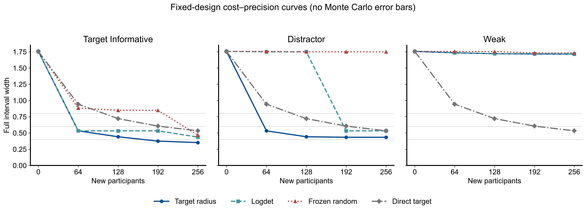
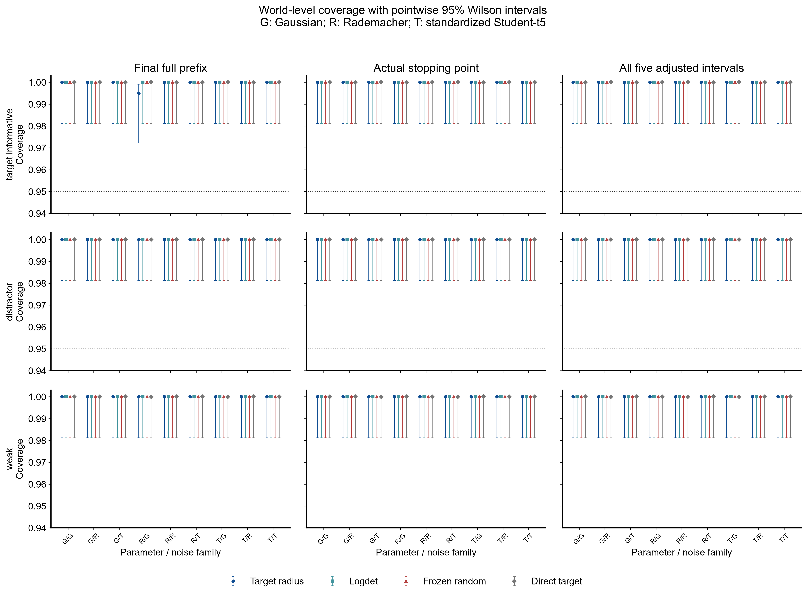

# 非高斯目标区间选桥：RUN01 结果

**核心结果：在 target_informative 和 distractor 两个预设几何中，目标半径桥接用 64 名新增参与者，直接目标实验用 256 名，得到相同的完整区间宽度 0.532657214043。新增人数减少 75%。** 这来自事先给定的 x=(2,0,0) 桥接 loading；不是普遍性结论。weak 场景桥接采满 256 人后区间仍宽于 .60，直接目标实验可以达到该精度。这里是预算内未达到预设精度，不是定理失效或估计错误。

本轮检验的是已知二阶矩、固定线性设计下的目标区间选桥。它把实际两臂观测、矩估计、区间、逐候选选择、采集与停止连接起来；不是原一般 U/L/H 工作流的重新验证。全部预设的 27 个几何×参数分布×噪声分布单元均保留。

输入：`reproduced/non_gaussian_target_run01/full`；profile=full，seed=2026110712，每单元 200 世界，共 5,400 世界，四方法、两种记录模式、五前缀，共 216,000 行。原始运行源提交 `793f7ae2c2a16b91cf8f00b7590749a1f2f52083`；其源快照及原始产物哈希由分析程序核对。

## 先解释一次实验

一次世界先生成一个共享的随机参数 beta，再生成两项各 32 人的历史实验。每次新实验有处理/对照各 32 人；个体噪声标准差为 0.5，所以 ATE 差均值噪声方差是 1/64。四方法共享相同历史、先验矩和真参数；相同实验身份共享同一个配对观测。不同新实验使用独立参与者和噪声流。桥接向量与 V0 均为 synthetic_known。真参数只进入生成器及评分，不进入选桥器。

主半径为 R=√(W/.05)，完整宽度为 2R；W=dᵀV0d+Σa²v。target_radius 枚举本轮剩余候选的更新 W，选最小者。权重、路径和宽度仅由设计决定，观测会改变点估计，但不会改变这条预先确定的路径。以下单世界固定为 distractor / Gaussian / Gaussian / replicate 0，未因结果好坏而挑选。

该世界真实目标效果（仅评分可见）为 **0.135515**。完整逐步数值、已观察效果、权重和分解见 `single_world_trajectory.csv`；处理与对照均值、采集身份和样本量见 `single_world_observations.csv`。

| budget_stage | new_participants | selected | estimate | width | parameter_component | noise_component | released |
| --- | --- | --- | --- | --- | --- | --- | --- |
| 0 | 0 | 仅历史 | 0.0113 | 1.7553 | 0.0383 | 0.0002 | False |
| 1 | 64 | b0 | 0.1434 | 0.5327 | 0.0003 | 0.0032 | True |
| 2 | 128 | b1 | 0.1801 | 0.4414 | 0.0002 | 0.0022 | True |
| 3 | 192 | b2 | 0.1606 | 0.4336 | 0.0001 | 0.0022 | True |
| 4 | 256 | b5 | 0.1604 | 0.4336 | 0.0001 | 0.0022 | True |

主停止规则第一次 R≤.30 即停止；stopped 后续预算行只是同一已停止输出的冻结视图。完整 prefix 会继续采满四批，专门用于同成本前沿；它不是已停止策略实际看过的数据。

## 同成本完整区间宽度

下表横轴是新增参与者，另有共同的 64 名历史参与者。费用只按人数计，不包括现实校准、审计、部署费用。所有分布组合和世界具有相同设计，因此同一几何/方法/预算的宽度完全相同：这里没有 Monte Carlo 成本或宽度置信区间，也不能把 200 次重复当作 200 次独立的设计优势证据。

| geometry | method | n=0 | n=64 | n=128 | n=192 | n=256 |
| --- | --- | --- | --- | --- | --- | --- |
| distractor | direct_target | 1.7553 | 0.9430 | 0.7208 | 0.6058 | 0.5327 |
| distractor | frozen_random | 1.7553 | 1.7545 | 1.7493 | 1.7491 | 1.7489 |
| distractor | logdet | 1.7553 | 1.7496 | 1.7490 | 0.5325 | 0.5325 |
| distractor | target_radius | 1.7553 | 0.5327 | 0.4414 | 0.4336 | 0.4336 |
| target_informative | direct_target | 1.7553 | 0.9430 | 0.7208 | 0.6058 | 0.5327 |
| target_informative | frozen_random | 1.7553 | 0.8832 | 0.8492 | 0.8490 | 0.4669 |
| target_informative | logdet | 1.7553 | 0.5327 | 0.5326 | 0.5325 | 0.4366 |
| target_informative | target_radius | 1.7553 | 0.5327 | 0.4414 | 0.3746 | 0.3518 |
| weak | direct_target | 1.7553 | 0.9430 | 0.7208 | 0.6058 | 0.5327 |
| weak | frozen_random | 1.7553 | 1.7545 | 1.7532 | 1.7316 | 1.7311 |
| weak | logdet | 1.7553 | 1.7338 | 1.7203 | 1.7183 | 1.7154 |
| weak | target_radius | 1.7553 | 1.7338 | 1.7203 | 1.7155 | 1.7141 |

### 严格相同宽度的成本对照

除了同一阈值达标，本表直接比较原始 prefix：target_radius 第 1 批与 direct_target 第 4 批。两者历史和先验相同。前者新增精度矩阵为 (2t)(2t)ᵀ/(1/64)=256ttᵀ；后者四批合计 4ttᵀ/(1/64)=256ttᵀ。因此 W 和区间宽度相同，仅观测噪声实现、中心和端点不必相同。完整精度匹配数值及浮点差值见 `exact_width_cost_matches.csv`。

| geometry | bridge_new_n | direct_new_n | bridge_width | direct_width | width_abs_difference | incremental_saving_fraction |
| --- | --- | --- | --- | --- | --- | --- |
| target_informative | 64 | 256 | 0.532657214043 | 0.532657214043 | 0 | 0.750000000000 |
| distractor | 64 | 256 | 0.532657214043 | 0.532657214043 | 0 | 0.750000000000 |

75% 是新增参与者节约：(256−64)/256。若把共同 64 名历史参与者也计入，总人数是 128 对 320，节约 60%；两者都不包含现实校准等费用。两个几何共享同一个 b0=2t 设计，因此不是两份独立的普遍性证据，更不能把跨分布/世界重复当作独立发现。

target_informative 与 distractor 的强桥接候选含 x=(2,0,0)，在同个体噪声与同人数下，观测对目标参数的 loading 是直接目标实验的两倍。因此首次桥接的优势有明确输入来源；不能据此声称任意桥接都优于直接目标实验。distractor 还含很大的非目标方向，logdet 会优先追求整体信息增量；本轮目标半径规则则直接追求目标精度。weak 菜单只有很弱的目标方向，用于检查候选信息不足时的行为。预算内未达到精度的结果必须与有利场景一起解释。

## 同精度首次成本及未达标

所有世界都保留在分母中。下表是完整区间宽度首次≤阈值所需的新增人数；未达标表示采满 256 人仍未达到，cost_to_success 为 NA，属于右删失，不能把 256 写作成功所需成本。该任务从完整 prefix 推导，和主 stopped 的 .60 阈值相同或不同均明确列出。由于路径固定，每个单元达标率只能是 0 或 1，不对此确定性比例构造抽样置信区间。逐世界与逐单元达标率/失败率及实际消耗见 attainment 表。

| geometry | method | width≤0.4 | width≤0.6 | width≤0.8 |
| --- | --- | --- | --- | --- |
| distractor | direct_target | 未达标 / NA | 256 | 128 |
| distractor | frozen_random | 未达标 / NA | 未达标 / NA | 未达标 / NA |
| distractor | logdet | 未达标 / NA | 192 | 192 |
| distractor | target_radius | 未达标 / NA | 64 | 64 |
| target_informative | direct_target | 未达标 / NA | 256 | 128 |
| target_informative | frozen_random | 未达标 / NA | 256 | 256 |
| target_informative | logdet | 未达标 / NA | 64 | 64 |
| target_informative | target_radius | 192 | 64 | 64 |
| weak | direct_target | 未达标 / NA | 256 | 128 |
| weak | frozen_random | 未达标 / NA | 未达标 / NA | 未达标 / NA |
| weak | logdet | 未达标 / NA | 未达标 / NA | 未达标 / NA |
| weak | target_radius | 未达标 / NA | 未达标 / NA | 未达标 / NA |

## 覆盖与错误发布

逐点主区间：540 个 cell×method×prefix 分组，经验覆盖范围 **99.50%–100.00%**；实际停止点：108 个分组，范围 **100.00%–100.00%**。每个分组分母为 200 个独立世界，不能把五前缀当五倍独立样本。

对五前缀另分配每步 .05/5 的失败预算，半径变成 √5 R；整条路径同时覆盖范围 **100.00%–100.00%**。主单次半径的五前缀同时覆盖也单独保留（99.50%–100.00%），只作诊断，不声称主半径有 95% 同时保证。

完整 prefix 的 interval_miss_on_release 合计 1 条、bad_release_scientific 合计 0 条。这些是相关前缀记录计数，不是独立事件样本量。前者指发布且真值不在自身区间内；后者指发布且点误差超过科学半宽 .30。二者不可互换。逐点率与 Wilson 区间使用全世界分母；条件于发布的诊断另列，零发布时为 NA。

Wilson 区间是逐格、未作全家族校正的 Monte Carlo 描述；全覆盖也不证明真实失败概率为零。Chebyshev 区间可能保守，本轮高经验覆盖不表示优于其它区间或精确达到名义覆盖。这里的概率针对随机参数与噪声的联合分布；不支持给定固定 beta 或给定结果后的条件覆盖。停止点由设计预先决定，因而仍为固定设计；不推到任意结果自适应停止。

## 审稿意见能推进到哪里

REV-10 / KoBT.W4：为取消 Gaussian 形状假设后的线性矩分支提供定理域内实现证据，并显示直接目标区间选择与 logdet 目标不同。仍依赖线性观测及可信的已知二阶矩，不回答现实输入和域外错设；不标 resolved。REV-07：提供共同信息、人数和可靠性口径下的四策略成本—精度对照；优势受几何 loading 限制，缺现实总成本和强外部基线。REV-12：区分完整前缀、实际停止、单次/路径区间和两种错误发布事件；不覆盖真实资格失败或任意适应性停止。

全部 12 项回顾：REV-01 得到指定单世界轨迹，作者理解仍待讨论；REV-02 无 R∞ 结果自适应效用证据；REV-03 不自动改摘要数字；REV-04 二阶矩为已知合成输入，真实集合/L/H 未解；REV-05 未提供真实闭环；REV-06 未新增 Many Labs；REV-07 有局部对照；REV-08 未证新颖性；REV-09 线性矩权重可有负值，但未证原凸组合类普适性；REV-10 有域内非高斯实现；REV-11 新分支源与协议可追溯，未完成全稿归属；REV-12 有局部统计语义验收。保持 tracker 状态，本报告不关闭任何问题。

## 验证与产物

独立分析的 118 项断言全部通过：包括原始产物哈希、完整分母、W 分解、W=q、单次/路径半径、rank-one 增益、每步目标最小值、成本、评分及停止后冻结。原运行测试记录位于 `test_log.txt`；这些实现检查和有限模拟都不能替代证明。

- `cell_prefix_stopped_summary.csv`：所有 27 单元×4 方法×2 模式×5 前缀的误差、宽度、覆盖与 Wilson 区间。
- `stopped_terminal_summary.csv`、`path_coverage_summary.csv`：实际停点与五前缀事件。
- `deterministic_width_cost.csv`、`exact_width_cost_matches.csv`：无重复伪精度的设计曲线及严格同宽度成本。
- `attainment_per_world.csv`、`attainment_summary.csv`：首次成本、失败分母及实际消耗。
- `single_world_trajectory.csv`、`single_world_observations.csv`、`single_world_initial_candidates.csv`：预先指定世界、已采集观测和第一次各候选评分。
- `analysis_checks.json`、`analysis_manifest.json`：核查、来源与分析版本。PDF 图与 PNG 图同名保存。
